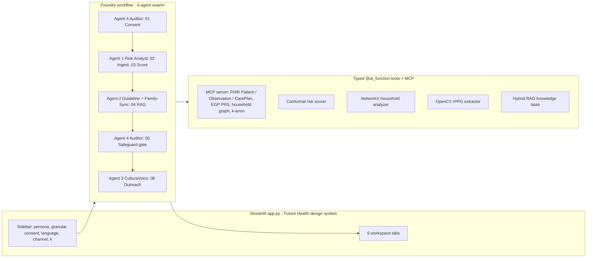

# VeloTech LifeCourse-360

**Multi-Agent Genomic, Household & Bio-Signal Precision Screening Ecosystem**
Team **VeloTech Health AI** · Lead role: AI & ML Engineer
Future Health Digital Innovation Challenge · Population Health · **Challenge 04: Precision Prevention and Screening**

> From signals to solutions. A consent-gated life-course engine that finds children, adults and households with unmet or elevated preventive need, shows how sure it is, and connects each person to the right Well-Child Visit or IFHAS pathway at the right time, in their language, for the whole family at once.

Everything runs **locally at $0**: no API key, no cloud, no real patient data. Optional free LLM endpoints (GitHub Models, Foundry Local, Ollama) plug in through the model router.

---

## 1. Quick start (Windows, VS Code)

```powershell
cd velotech-lifecourse-360
python -m venv .venv
.venv\Scripts\activate
pip install -r requirements.txt
streamlit run app.py
```

Or open the folder in VS Code and press **F5** (`VeloTech LifeCourse-360: Streamlit (Run & Debug)` in `.vscode/launch.json`). The first load trains the risk models on 10,000 synthetic residents (about 5 seconds), then everything is cached.

Other launch configs: `VeloTech: MCP Server (stdio)` and `VeloTech: 4-Agent Swarm smoke test` (prints OpenTelemetry-style spans to the terminal).

### Page design

The page follows an editorial landing-page structure inspired by the Future Health challenge portal (full-width sand, white and taupe bands, a plain text nav, a light display heading, a stat strip, a focus-area explorer, a timeline, a two-column FAQ and a link-column footer). All content, illustrations and layout details are original to this project.

### First open: guided tour, light and dark mode

- On the first load a **welcome pop-up with a guided tour** appears (11 short steps: what to click, what you should see). Reopen it any time with the **Guided tour** button in the sidebar. The same checklist is the first question in the FAQ at the bottom of the page.
- **Check your own data**: besides the 8 sample people, choose **My own data** in the sidebar (*Choose a person*) to open a form. Enter age, check-up history, labs, family history, development, environment and (for Emirati nationals) genomic fields. Blank fields count as *missing*, never zero; a live completeness message shows whether the 40% minimum for a risk estimate is reached. Your entry lives only in the browser session and is never saved. Code: `src/own_data.py` (form) and `build_custom_persona` in `data/synthetic_generator.py`.
- **Color theme**: four palettes, each with a light and a dark variant: **Ocean** (teal, the default), **Indigo**, **Forest** and **Sand** (the original warm palette). Pick one from *Color theme* at the top of the page or in the sidebar.
- **Light / dark mode**: use the *Dark mode* switch next to it. Both choices are kept in the URL, so you can open `http://localhost:8501/?theme=dark&palette=Indigo` directly.
- The base Streamlit theme is fixed to light in `.streamlit/config.toml`; the app re-skins every component (including inputs, dropdowns, dialogs, tables, JSON viewers and charts) for dark mode.

### Troubleshooting: `module 'cv2' has no attribute 'CascadeClassifier'`

OpenCV 5.0 removed that class. `requirements.txt` now pins `opencv-python-headless<5`, and the app also works on OpenCV 5 (it falls back to a colour-based face region). To reinstall cleanly:

```powershell
pip uninstall -y opencv-python opencv-python-headless opencv-contrib-python
pip install "opencv-python-headless>=4.9.0.80,<5"
```

### Optional extras (all tested)

```powershell
pip install mcp fairlearn
```

- `mcp` turns `src/mcp_server.py` into a real Model Context Protocol server over stdio (works with both the 1.x `FastMCP` and 2.x `MCPServer` SDKs). Without it the built-in JSON-RPC server is used, so the app works either way. `.vscode/mcp.json` registers the server for VS Code.
- `fairlearn` adds a cross-check of the selection-rate parity gap in tab 4.
- `shap` and the `agent-framework` package are **not** needed: exact linear SHAP and the agent classes are built in.

### Optional live LLMs (all free tiers)

| `VELOTECH_LLM_MODE` | Needs | Used for |
|---|---|---|
| `offline` (default) | nothing | deterministic engine, templated multilingual outreach |
| `github` | `GITHUB_TOKEN` | GPT-4o-mini via GitHub Models |
| `foundry` | Foundry Local running (`FOUNDRY_LOCAL_ENDPOINT`, default `http://localhost:5272/v1`) | Phi-4. Ollama also works: set `FOUNDRY_LOCAL_ENDPOINT=http://localhost:11434/v1` and `FOUNDRY_LOCAL_MODEL` |
| `JAIS_ENDPOINT` env var | any OpenAI-compatible Jais endpoint | Arabic routing |

Any endpoint failure falls back to the deterministic engine and is logged as a trace span. Message bodies are always the vetted templates; a live model only adds an optional clinician-facing narrative sentence.

---

## 2. What it does, mapped to the five mandatory outcomes

| # | Outcome | Where to see it | Implementation |
|---|---|---|---|
| 1 | Transparent risk and care-gap identification | Tab 1 | Calibrated logistic models (Platt-recalibrated), exact **SHAP** attribution, **split-conformal 95% interval** (Mondrian by data-completeness band), class-conditional conformal sets, **authorized-data provenance badge**, FHIR R4 viewer |
| 2 | Personalized preventive pathways and household synchronization | Tab 2 | **Foundry IQ-style hybrid RAG** (BM25 + TF-IDF cosine) over DoH Well-Child and IFHAS guidance; timing windows, fasting rules, recall intervals, follow-up; **NetworkX household graph** and the *Synchronized Family Prevention Appointment*; permanent population-vs-clinician boundary banner |
| 3 | Culturally appropriate engagement, consent choice, optional OpenCV pre-screener | Tab 3 + sidebar | Arabic (Emirati / Standard), English, Urdu × WhatsApp / SMS / App / Voice, parent vs adult/worker tone; **granular consent checkboxes synced between sidebar and workspace** with live recalculation; OpenCV green-channel **rPPG** pulse, pediatric milestone and gaze-tracking check, simulated wearable hook |
| 4 | Local population safeguards and low-data fallbacks | Tab 4 | Reach, FPR, FNR, recommendation rate, uptake by region / nationality / occupation / age band / sex; Fairlearn-compatible parity gaps; **k-anonymity suppression** (slider 5–25, default 10, string `[SUPPRESSED: n < k Privacy Safeguard]`); **below-40% completeness fallback** to the baseline DoH age/gender schedule; consent-sweep simulator |
| 5 | Outcome-based evaluation and calibration | Tab 5 | Reliability diagram, Brier, ECE, decision curve analysis, completed Well-Child / IFHAS visits, timely vs overdue, closed-loop funnel, early detections, estimated QALYs |

Sibling focus areas are handled inside the same engine: screening-to-care loop closure (IF-12, funnel), climate-resilient worker health (heat and PM2.5 features, heat-stress kidney panel), brain health and mental wellbeing (M-CHAT-R/F, PHQ-9/GAD-7, cognitive baseline), healthy behaviours and inherited risk (EGP flags, tobacco support, carrier counselling).

---

## 3. Architecture



### Repository layout

```
velotech-lifecourse-360/
├── .streamlit/config.toml          base theme + minimal toolbar
├── .vscode/            launch.json, settings.json
├── assets/favicon.png              app icon
├── data/synthetic_generator.py     population, 8 personas + "My own data" persona, EGP records, household graphs
├── src/config.py                   design system: light + dark palettes, CSS, SVG wave, contact bar, footer, themed tables
├── src/tutorial.py                 guided tour content (pop-up + FAQ checklist)
├── src/own_data.py                 "My own data" entry form (blank = missing, live completeness check)
├── src/doh_guidelines_kb.py        Foundry IQ hybrid RAG + pathway builder
├── src/ml_conformal_engine.py      risk models, SHAP, conformal, calibration, DCA
├── src/opencv_biosignal.py         rPPG, pediatric milestones, wearable adapter
├── src/safeguards_evaluation.py    k-anonymity, parity, consent sweep, outcome simulation, docs
├── src/mcp_server.py               MCP server (JSON-RPC + FastMCP)
├── src/foundry_agents.py           model router, agents, workflow, tracing, outreach studio
├── app.py                          the application
└── requirements.txt
```

### The six-state workflow

`01_Consent_Verification` → `02_MCP_FHIR_Signal_Ingest` → `03_Conformal_Risk_Scoring` → `04_Foundry_IQ_Guideline_RAG` → `05_Responsible_AI_Safeguard_Gate` → `06_CulturaVoice_Outreach_Dispatch`

If the gate returns `blocked` (for example no consented data at all), state 06 is held for human review and nothing is dispatched. Below 40% completeness the verdict is `passed with fallback`: the risk is withheld and the invitation offers the standard age-based check-up.

---

## 4. Microsoft AI-103 coverage

The **Foundry** tab shows a live compliance matrix with evidence counters (spans, MCP calls, citations, gate checks) computed from the current run.

| # | Capability | Implementation |
|---|---|---|
| 1 | Select, deploy, evaluate Foundry models | `ModelRouter` compares Phi-4, GPT-4o-mini, Jais profile and the deterministic engine on groundedness, clinical relevance, cultural appropriateness and latency |
| 2 | Generative apps that use tools | Streamlit invokes typed tool pipelines; calls listed per run |
| 3 | Agents with Foundry and VS Code | `launch.json`, `settings.json`, OTel-style spans (`VELOTECH_TRACE_STDOUT=1`) |
| 4 | Custom tools | `@ai_function` scorer, household analyzer, rPPG extractor, guideline retriever |
| 5 | MCP tools | `src/mcp_server.py` (FHIR R4, EGP PRS, kinship graph, k-anon); `MCPClient` traces every `tools/call` |
| 6 | Foundry IQ RAG | `src/doh_guidelines_kb.py` with citation snippets and a groundedness verifier |
| 7 | Agent-driven workflow | six-state machine above |
| 8 | Microsoft Agent Framework agent | specialist agent classes, `@ai_function` pattern |
| 9 | Multi-agent orchestration | four-agent swarm |
| 10 | Responsible generative AI | gate: boundary notice, completeness fallback, ECE, conformal coverage, retrieval agreement, groundedness, parity, k-anon, message checks |

Note on the Agent Framework: `ai_function` and the agent classes follow the SDK's *pattern* and are implemented locally so the project has no cloud dependency. Porting to the `agent-framework` package means swapping the decorator and base class.

---

## 5. Measured results (synthetic data, held-out test split, seed 7)

| Metric | Value |
|---|---|
| Test set | 2,500 people, 20.6% with unmet need |
| AUC | 0.737 |
| Brier score | 0.139 |
| Expected calibration error | **0.009** after Platt recalibration (0.020 before) |
| 95% conformal interval coverage | **95.5%** (half-width 14.8% high completeness, 16.3% mid, 26.3% low) |
| Conformal set coverage | 95.5%, mean set size 1.75 of 2 (see limitations) |
| Equalised-odds gap across regions at threshold 0.30 | 4.1% |
| Modelled early detections at 25% capacity | 473 vs 274 for age-rule outreach (**+73%**) |
| Modelled outreach cost per early detection | AED 1,583 vs AED 2,407 |
| Scoring throughput | about 148,000 rows per second on the build machine |

These are properties of a **synthetic** world whose labels were generated from clinically motivated relationships. They demonstrate that the machinery is correct and calibrated, not that it will perform this way on real people.

---

## 6. Assumptions

**Data**
- All records are synthetic. No real patient, EGP genome, Malaffi payload or DoH document is used.
- The Emirati Genome Program covers Emirati nationals only, so non-Emirati personas have no genomic record.
- Missingness is correlated with geography and occupation (Al Dhafra and outdoor workers have fewer labs), to make the fairness audit meaningful.

**Modelling**
- Two segment models (Well-Child, adult) because the clinical features differ. Logistic regression gives exact SHAP and is easy for clinicians to audit.
- The conformal interval is calibrated against a synthetic *adjudicated-risk proxy*. In deployment replace it with adjudicated clinical risk, or use Venn-Abers or bootstrap intervals.
- Hard clinical red flags (FH variant, LDL ≥ 4.9 mmol/L, HbA1c ≥ 6.5%, eGFR < 60 with raised uACR, M-CHAT-R/F ≥ 3) escalate urgency regardless of the statistical score.

**Clinical**
- The guideline chunks are **paraphrased demonstration summaries** that follow the structure of the DoH Well-Child Visit and IFHAS programmes and widely used conventions (WHO anemia cut-off, M-CHAT-R/F bands, PHQ-9 bands, KDIGO CKD criteria). They are **not the official text**. A pilot must load the current DoH documents and have clinicians approve every rule.
- Recall intervals are 6 months to age 2 and 12 months to age 5 for children, 36 months for adults under 40 and 24 months from 40.

**Outcome simulation** (editable in `ASSUMPTIONS`)
- Programme can actively invite 25% of the population; tailored engagement adds 8 points of uptake and household synchronization 5 more for children.
- Completed visit detects a true need with probability 0.85 (adult) or 0.80 (child); 0.35 / 0.50 QALYs per early detection; AED 18 per invite and AED 450 per visit.
- Loop-closure conversion rates for age-rule vs navigator-supported follow-up are stated constants, not measurements.

---

## 7. Known limitations

In short (the same five points appear in the app under *Technical Documentation & FAQ → What are the known limitations?*):

- No real patient, EGP or Malaffi data was used; performance on real data is unknown.
- Webcam rPPG from a single photo is simulated; real rPPG needs video and is sensitive to lighting, motion and skin tone. It is a motivational wellness indicator only.
- Translations are templated and need review by native clinical translators and DoH communications.
- The offline model profiles for Phi-4, GPT-4o-mini and Jais show reference values until a live endpoint is configured.
- Household inference is by shared household id; kinship ambiguity and shared-device privacy need a consent design review.

Details:

- **Performance on real data is unknown.** AUC is modest (0.74) by construction, and at the default threshold roughly 56% of true need is missed (reach about 44%). Lowering the threshold trades reach for more false positives; the decision curve shows the trade.
- **Conformal sets are often uninformative.** With modest discrimination the class-conditional sets usually contain both classes (mean size 1.75). The guarantee holds (95.5% coverage), but the sets are mostly an honest "uncertain" signal rather than a decision aid.
- **rPPG from a webcam photo is simulated.** A single image cannot carry a pulse. The still is used for real face, lighting and sharpness checks and a simulated pulse is injected into the real pixels so the pipeline can be demonstrated. Real rPPG needs video and is sensitive to light, motion and skin tone. It is a motivational wellness indicator, never an input to the clinical score.
- **Model comparison rows for Phi-4, GPT-4o-mini and Jais are illustrative priors** until a live endpoint is configured; the deterministic engine row is measured.
- **Translations are templated** and need review by native clinical translators and DoH communications. Arabic messages keep the person's first name in Latin script.
- **Household inference** is by shared household id; kinship ambiguity and shared-device privacy need a consent design review.
- **Verification scope:** the interface was checked in headless Chromium in both light and dark mode across the hero, tour, sidebar (including an open dropdown), all six tabs, the OpenCV pre-screener (adult and child modes) and the footer. It was not checked in Safari or Firefox, and `st.camera_input` (live webcam capture) was not exercised. The logic was tested headlessly across all personas, languages, channels, consent states and slider ranges.
- Not a medical device. Final clinical decisions rest with licensed physicians.

---

## 8. Data governance and responsible AI

- **Consent is enforced before scoring**: unauthorized domains are removed from the feature vector, not just hidden.
- **Below 40% authorized completeness the AI refuses to extrapolate** and the baseline schedule applies.
- **k-anonymity** suppression (default k=10) applies to cohort tables and charts; suppressed cohorts are never plotted.
- **Boundary**: every workspace tab and every FHIR CarePlan carries the population-prioritization vs individual-clinical-decision notice. CarePlans use `intent: proposal`, `status: draft`.
- **Messages** are checked for opt-out, non-diagnostic wording, no risk percentages, matching script and SMS length.
- **Fairness**: parity gaps above 10 points are amber and above 20 red; an optional FNR-parity threshold adjustment is available as post-processing.

---

## 9. Judge evaluation guide (5-minute demo)

1. **Fatima Al Mansoori** (default). Tab 1: risk with ± interval, SHAP bars, provenance badge. Tab 2: pathway with citations, then the household graph and the **Synchronized Family Prevention Appointment** with Omar.
2. **Untick "Laboratory results"** in the sidebar: the risk and interval recalculate (the interval widens as completeness falls). Click **Revoke most**: the fallback banner appears, risk is withheld and the baseline schedule applies.
3. **Khalid Al Dhaheri**: EGP familial hypercholesterolemia flagged *Urgent* although he would not be invited by age rules.
4. **Imran Hussain** (Urdu, SMS, Al Dhafra): heat-stress kidney panel, no genomic record, Urdu invitation with shift-friendly slots. Tab 4 shows the Al Dhafra fallback rate.
5. **Daniel Thompson**: 25% completeness, risk blocked by design.
6. Tab 3: switch language and channel, enable the OpenCV pre-screener in the sidebar, tick the bio-signal consent, and watch the pulse waveform and spectrum. Try **Omar** for the pediatric milestone and gaze-tracking check.
7. Tab 4: drag **k** from 5 to 25 and watch suppressed cells change.
8. Tab 5: reliability diagram, decision curve, funnel, QALYs.
9. Tab 6: the six-state workflow, MCP request/response inspector, span waterfall, model router and the AI-103 matrix.
10. **My own data**: enter a real-looking profile and watch the result, the uncertainty range and the 40% completeness guard respond to what you fill in.

---

## 10. Path to pilot

1. Data-sharing agreement and governance approval with DoH, Malaffi and EGP custodians.
2. Replace demo guideline chunks with the official DoH documents; clinician sign-off on rules and message templates.
3. Retrospective validation: discrimination, calibration and fairness by subgroup, decision-curve benefit; replace the proxy-based conformal calibration with adjudicated outcomes.
4. Silent-mode prospective run, then a controlled pilot comparing outreach strategies on attendance, detection and loop closure with partners such as SEHA, PureHealth, M42, Mediclinic and Burjeel.

---

## 11. Team

**Muhammad Tehzeeb ul Hassan**, Team Lead, AI & ML Engineer, VeloTech Health AI
GitHub: <https://github.com/Tehzeb> · LinkedIn: <https://www.linkedin.com/in/muhammad-tehzeeb-ul-hassan/> · Email: tehzeeb.x51214@gmail.com

**Hajra Bibi**, Team Member, AI Engineer, VeloTech Health AI
GitHub: <https://github.com/HajraBibi73> · LinkedIn: <https://www.linkedin.com/in/engr-hajra-bibi-4103042a5> · Email: hajramurtaza260@gmail.com

Prototype and technical documentation due **20 November 2026**; finalists present at **GITEX 2026 (7–11 December)**.
